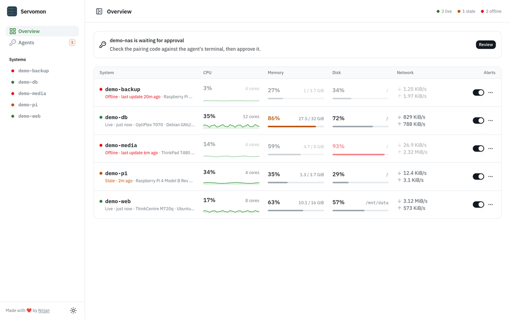
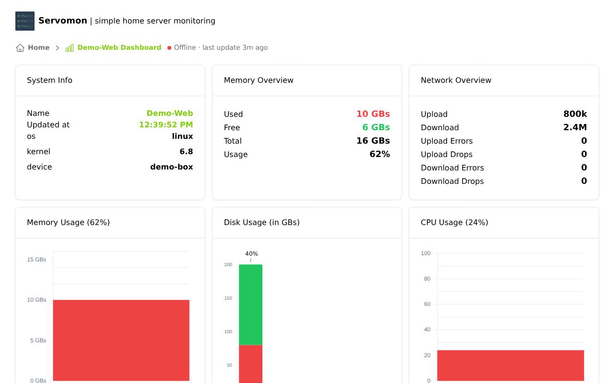
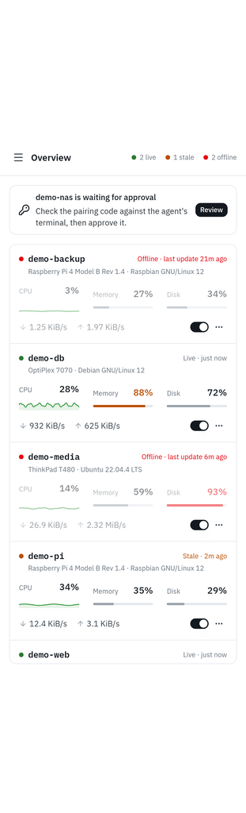

# Servomon - Simple Home Server Monitoring

Servomon helps you monitor Linux servers through an easy-to-use web app. It consists of two parts:
- A web app for viewing server metrics
- An agent that runs on your servers to collect and send data

## Key Features

- **Secure by default**: the dashboard and API require an operator login; each agent gets its own token via dashboard approval (see "Adding an agent"); WebSocket connections use single-use handshake tickets ([how they work and why](docs/websocket-auth.md)) and every forwarded command is audit-logged
- **Comprehensive Monitoring**:
  - Memory usage
  - Network performance (speed, errors, drops)
  - Disk usage
  - CPU usage
  - Battery percentage
  - Docker container stats
  - Top process tracking
- **Remote Management**:
  - Stop, pause and unpause Docker containers
  - Kill active processes
- **Flexible**:
  - Monitor multiple servers
  - Install as PWA on your phone
- **Alerting**:
  - Web push notifications
  - Discord Alerts
  - Supports these alerts by default: low battery, low storage, and server downtime





## Installation

### Web App

#### Option 1: Local Docker Install
1. Clone the repository
2. Navigate to the web directory
3. Create an `.env` file: `cp .env.example .env`, then set `NUXT_BASIC_AUTH_USERS` to at least one `user:password` pair (required — without it every route denies all requests)
4. Start container: `docker compose up -d`
5. Open `http://localhost:3000` and log in

#### Option 2: Fly.io Deploy
1. Edit `fly.toml` as needed
2. Create data volume: `fly volumes create data`
3. Set secrets: `fly secrets set NUXT_BASIC_AUTH_USERS="you:strong-password"`
4. Deploy: `fly deploy`

> Fly.io terminates TLS for `*.fly.dev` automatically. If you self-host elsewhere, serve the app behind TLS (Caddy, Tailscale Serve, Cloudflare Tunnel, …) — agent tokens travel in HTTP headers and must never cross the network in cleartext.

### Agent Setup

The agent runs on Linux x86_64 (command execution shells out to `kill` and the `docker` CLI, which have no Windows equivalent).

1. Download `servomon-agent-linux-x86_64` from the latest [GitHub Release](https://github.com/nirjan-dev/servomon/releases) (verify with `SHA256SUMS`), or build from source: `cd agent && deno task build`
2. Make executable: `chmod +x path/to/executable`
3. Create `.env` file in same folder (copy from `/agent/.env.example`), setting `SERVER_URL` and `NAME`. Leave `AGENT_TOKEN` empty.
4. Run from that folder: `/path/to/binary/servomon-agent` (it reads `.env` and stores its identity in the working directory)

### Adding an agent

On first run (no `AGENT_TOKEN`), the agent prints a pairing code and waits:

1. Open the dashboard and log in with your operator credentials.
2. In the **Agents** section, find the pending request. Check the fingerprint matches what the agent printed.
3. Click **Approve**. The agent receives its token automatically and starts sending metrics.

For the protocol walkthrough, diagrams, recovery behavior, and current security limits, see [Agent enrollment](docs/agent-enrollment.md). Token collection requires a device-only secret the agent generates at request time — the pairing code alone only identifies the request. The displayed fingerprint is a comparison label, not verified proof of private-key ownership.

To remove an agent, click **Remove** next to it. Its token stops working immediately and its connection is closed. Pairing codes expire after 15 minutes; denied requests never receive a token.

To fully delete a monitored system — its card on the dashboard, stored metrics, alert config, and enrollment — click **Delete** on its system card. This cannot be undone.

To run in background:
- Quick method: Press `Ctrl + Z`, then type `bg`
- Recommended: Set up systemd service
  - Example file at `/agent/servomon_agent.service`
  - Replace `User=username`, `WorkingDirectory=` (must be the folder holding the binary and `.env`), and the `ExecStart=` path, then copy to `/etc/systemd/system/`
  - Run:
    ```
    sudo systemctl daemon-reload
    sudo systemctl enable servomon_agent
    sudo systemctl start servomon_agent
    systemctl status servomon_agent
    ```

## Tech Stack

- [Deno](https://deno.com): JavaScript runtime used to compile the agent into an executable binary.
- [Nuxt](https://nuxt.com): Fullstack Typescript framework that powers the web app.
- [Nuxt UI & Tailwind](https://ui.nuxt.com): For UI components and custom styling
- [Zod](https://zod.dev): For runtime validation
- [@unovis/vue](https://unovis.dev/): Library for chart components
- [Typescript](https://www.typescriptlang.org/)
- Websockets: For running commands sent from the web app on the servers.
- [systeminformation](https://systeminformation.io/): Library to collect system information from the servers

## License
[MIT](https://github.com/nirjan-dev/servomon/tree/main/LICENSE)
