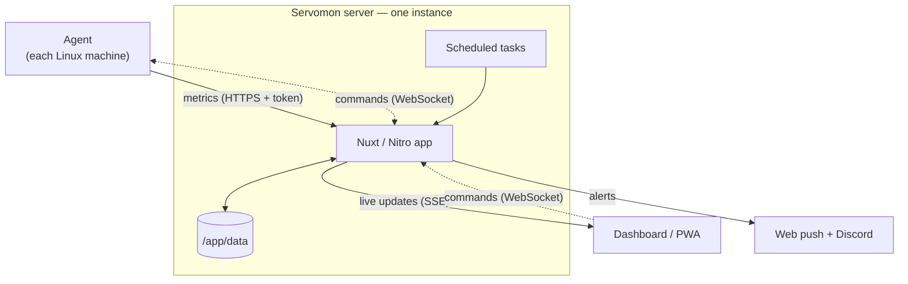

# How Servomon fits together

One long-lived server connects your browser to agents on your Linux machines. Agents send metrics and maintain a command connection; the dashboard streams metric updates rather than repeatedly downloading full history.

## From installation to live data

1. An agent with no token requests enrollment and prints a pairing code and fingerprint label.
2. An operator approves it on **Agents**. The agent saves its token to its working-directory `.env`; its identity stays in `.servomon-identity.json`.
3. The agent posts metrics with that bearer token (every six seconds by default).
4. For commands, the agent exchanges its token for a single-use ticket at `POST /api/ws-ticket` and connects to `/api/ws`. The browser obtains an operator ticket using its login. Every reconnect needs a new ticket.
5. The server forwards commands to the matching agent, tracks replies and writes audit entries. The agent's OS permissions determine what commands can do.

## Storage and retention

In the container, mount a persistent volume at **`/app/data`**. It contains filesystem-backed metrics, agent registry, push subscriptions, system settings, server state (including automatically generated push keys) and audit data. Back it up before upgrades. An agent's local identity/token files are separate and also sensitive.

Every two minutes, cleanup keeps metric samples in the **24-hour window intersected with the newest 500**, with a floor of the **newest five** even if old. At the default six-second interval, the 500-sample cap is reached before 24 hours. This is a bounded recent view, not 24 hours of guaranteed samples. The policy describes metrics, not a blanket retention guarantee for every stored record.

The browser receives a sync on connection, deltas after that, and periodic resyncs; its history is capped at 500 samples per system.

## Scheduled alerts

| Task | Schedule | Behavior |
| --- | --- | --- |
| Healthcheck | Every minute | Detects systems with no fresh metrics within three minutes; alerts on down/recovery transitions |
| Battery | Hourly | Alerts below 50% charge; skips machines without a battery |
| Storage | Daily at 09:00 (server scheduler time) | Alerts for disks at or above 80% used |
| Cleanup | Every two minutes | Applies the metric retention policy |

Per-system alert toggles gate push and Discord delivery. See [notifications](/notifications).

## Why only one server instance?

Active WebSockets, pending enrollments and single-use tickets are held in memory. The scheduler runs in that same process, and data is written to a local filesystem. Adding replicas would split connections and tickets, duplicate scheduled work and require coordinated storage. Keep **one running instance** with a persistent disk; a restart drops connections and pending pairing requests, but enrolled agents and stored data survive and agents reconnect.

Supported deployment paths are [Docker](/server-docker), [Fly.io and Render](/server-hosted). For protocol details and trade-offs, read [WebSocket authentication](/websocket-auth) and [agent enrollment](/agent-enrollment).
