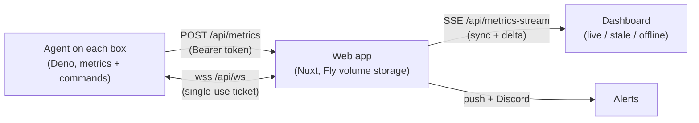

# Installation & setup

## Web app

**Docker (local):**

1. Clone the repository.
2. `cd web`, then `cp .env.example .env` and set `NUXT_BASIC_AUTH_USERS` to at least one `user:password` pair (required — without it every route denies all requests).
3. `docker compose up -d`, then open `http://localhost:3000` and log in.

**Fly.io:**

1. Edit `fly.toml` as needed.
2. `fly volumes create data`.
3. `fly secrets set NUXT_BASIC_AUTH_USERS="you:strong-password"`.
4. `fly deploy`.

> Fly.io terminates TLS for `*.fly.dev` automatically. If you self-host
> elsewhere, serve the app behind TLS (Caddy, Tailscale Serve, Cloudflare
> Tunnel) — agent tokens travel in HTTP headers and must never cross the
> network in cleartext.

## Agent (Linux x86_64)

Command execution shells out to `kill` and the `docker` CLI, so the agent is
Linux-only.

1. Download `servomon-agent-linux-x86_64` from the latest
   [GitHub Release](https://github.com/nirjan-dev/servomon/releases) (verify
   with `SHA256SUMS`), or build from source: `cd agent && deno task build`.
2. `chmod +x` the binary.
3. Copy `agent/.env.example` to `.env` beside it; set `SERVER_URL` and `NAME`.
   Leave `AGENT_TOKEN` empty.
4. Run it from that folder. On first run it prints a pairing code — approve it
   in the dashboard's **Agents** section and it starts sending metrics.

For background operation, use the example
[`servomon_agent.service`](https://github.com/nirjan-dev/servomon/blob/main/agent/servomon_agent.service)
unit: replace `User=`, `WorkingDirectory=` (must hold the binary and `.env`),
and the `ExecStart=` path, copy to `/etc/systemd/system/`, then
`daemon-reload`, `enable`, `start`.

## How it fits together

Next: read [WebSocket authentication](websocket-auth.md) and
[Agent enrollment](agent-enrollment.md) for the security design, or
[watch the demo](demo.md).
