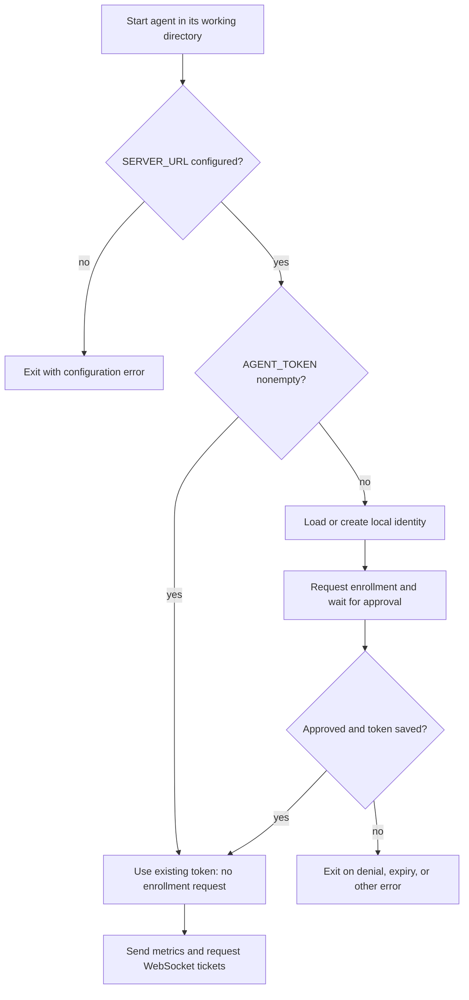
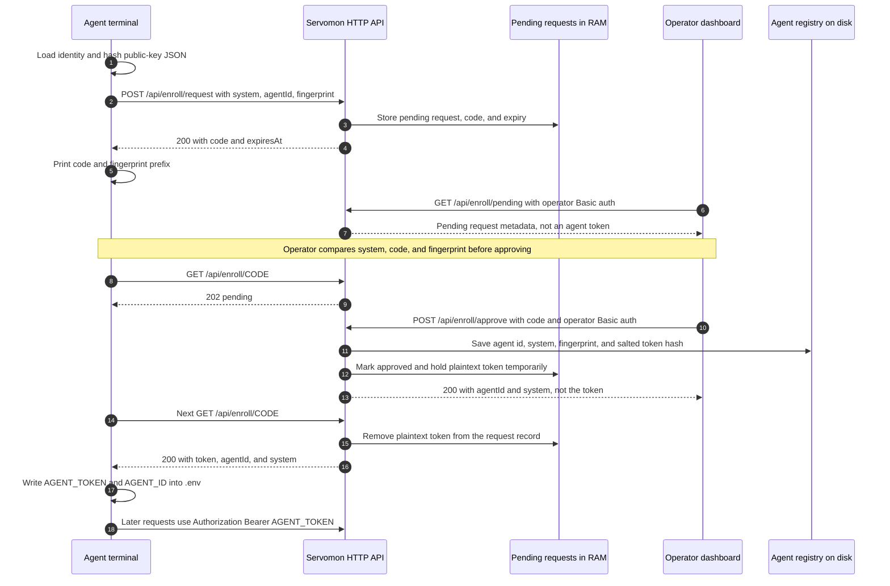
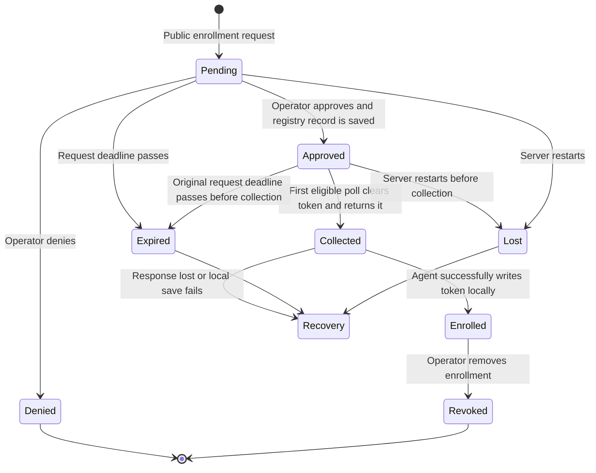
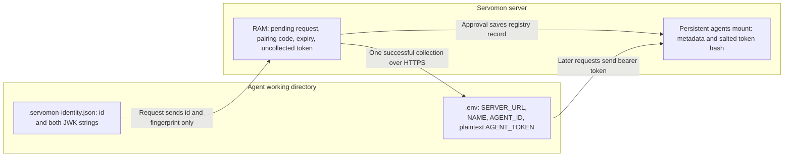

# Agent enrollment: from a new machine to an approved client

Enrollment answers **“should this Servomon instance trust this new agent?”** It happens before metrics ingestion or the [WebSocket ticket flow](websocket-auth.md). The operator approves a request in the dashboard; the server creates a per-agent bearer token; the agent saves it locally for future requests.

This document describes the implementation currently in the repository, not an idealized protocol.

> **Security boundary:** approval is required, but token collection is authorized only by knowledge of the pairing code. The generated keypair does not authenticate the agent: no signature or private-key proof is checked. Treat the pairing code as a temporary secret. The [security limitations](#security-limitations-and-recommended-changes) below include weaknesses that should be addressed before calling this cryptographically verified device enrollment.

## Three different questions

- **Enrollment:** may this machine join? Answered by the operator's approval.
- **Agent authentication:** which enrolled system is making this HTTP request? Answered by its `AGENT_TOKEN` and the server's token record.
- **WebSocket admission:** may this connection open now, and as which role? Answered by a separate short-lived, single-use ticket.

The pairing code is not the agent token, and the agent token is not the WebSocket ticket.

## 1. What starts enrollment?

`agent/main.ts` loads the environment using `@std/dotenv/load`. It calls `enrollAgent(SERVER_URL, NAME, Deno.cwd())` only when `AGENT_TOKEN` is empty or absent.



Important consequences:

- Building or replacing the executable does not itself trigger enrollment.
- A stale or revoked nonempty token also skips enrollment. The server rejects it; the agent does not automatically clear it or re-enroll.
- The working directory matters. The `.env` and `.servomon-identity.json` involved here are in `Deno.cwd()`, not necessarily beside the executable. Set the service's `WorkingDirectory` accordingly.
- `NAME` must pass the server's validation: 1–64 characters, starting with an ASCII letter or number, then letters, numbers, `.`, `_`, or `-`.
- `SERVER_URL` must point at the intended instance. Use HTTPS outside an isolated localhost check. The current helper does not enforce an HTTPS URL itself.

## 2. What gets created, and which values are secrets?

| Value | Meaning and creation | Storage / lifetime | Security role |
|---|---|---|---|
| `system` / `NAME` | Human-readable monitored-system name | Agent configuration and server record | An identifier, not a credential |
| `agentId` | `agent-` plus `crypto.randomUUID()` on the agent | Local identity file and server record | An identifier, not proof of identity |
| P-256 keypair | Generated with Web Crypto ECDSA | Both keys, exported as JWK strings, in `.servomon-identity.json` | Private material exists, but is not used for signing or authentication in this implementation |
| `fingerprint` | SHA-256 of the UTF-8 public-key JSON string | Pending request and enrolled record | A comparison label; the server never receives the public key or verifies that this hash belongs to it |
| Pairing `code` | Server-generated 6 random bytes encoded as 12 uppercase hex characters: 48 bits | Server memory, expires 15 minutes after the initial request | Also the credential for collecting the issued token; keep it secret |
| `AGENT_TOKEN` | Server-generated 32 random bytes, base64url encoded: 43 characters, 256 bits | Plaintext in agent `.env`; salted scrypt hash on server; no automatic expiry | The actual reusable bearer credential |
| `AGENT_ID` | Agent id written into `.env` after collection | Agent `.env` | Informational; runtime authentication uses the token, not this setting |
| WebSocket ticket | Minted later using the token | Memory; normally 60 seconds and single-use | Admission to one WebSocket connection, explained separately in [WebSocket authentication](websocket-auth.md) |

A fingerprint hash and a token hash serve different purposes. The fingerprint is displayed to help a human compare requests. The salted token hash lets the server verify a supplied secret without keeping a recoverable copy of that secret in the agent registry. Neither operation encrypts the token for delivery.

The fingerprint is specifically a hash of a JSON string, not a standardized, canonical JWK thumbprint. Both the agent console and dashboard show only its first 19 hex characters followed by an ellipsis; the server stores the full submitted value.

## 3. First run, step by step

### Local identity

`agent/lib/enroll.ts` first tries to read `.servomon-identity.json`. If it contains `agentId`, `privateKey`, and `publicKey`, those values are reused. If the file is missing, unreadable, or lacks those fields, a new identity is generated and written with requested mode `0600`.

This is a field-presence check, not a cryptographic validation of the file. The file is not uploaded. Only the agent id, system name, and fingerprint are sent to the server.

### Request, approval, and delivery



**Request.** `POST /api/enroll/request` is intentionally public: a machine has no credentials yet. The server validates the submitted fields, rejects an already-enrolled system name, then stores a pending record in memory. It returns `{code, expiresAt}`; no agent token exists at this stage.

If the same agent id already has a live pending request, matching `system` and `fingerprint` return its existing code. Different metadata for that pending id returns 409. This retry behavior does not prove that the requester owns the original identity; see the security limitations below.

**Operator review.** `AgentsManager.vue` fetches pending requests and enrolled agents immediately, then every 15 seconds. Only an authenticated operator can list, approve, or deny pending requests. Compare the code shown by the terminal you started, not just a familiar hostname. A displayed fingerprint is not independently verified by the server.

**Approval.** The server looks up the pending code, checks its status and expiry, and checks again that its system name is not enrolled. It generates a fresh token, hashes it using scrypt with a random 16-byte salt and 32-byte output, and persists a record:

```text
agentId, system, tokenHash, fingerprint, createdAt, lastSeenAt
```

The `tokenHash` is stored as `saltHex:derivedHex`. `lastSeenAt` starts as `null`. Although `createAgentRecord()` generates an id, the approval handler overwrites it with the id submitted by the agent; that client-supplied id is the registry key actually used.

The plaintext token is kept on the approved in-memory enrollment record until collected. The approval response to the dashboard contains only the agent id and system name, not the token.

**Collection.** The agent waits five seconds between polls to `GET /api/enroll/:code`. An approved response contains `{status: "approved", agentId, system, token}`. The handler clears the token from the in-memory record before returning it. A later poll returns 410.

This is **one successful collection-handler execution**, not guaranteed delivery to exactly one intended device. The handler has no acknowledgement from the agent that the response arrived or was saved.

**Saving and continuing.** The helper updates or appends `AGENT_TOKEN=` and `AGENT_ID=` in the working-directory `.env`. `main.ts` also sets the token in the current process, so it can continue without a restart. The agent now posts metrics and exchanges its token for WebSocket tickets. It does not send the pairing code or use its private key for those requests.

## 4. Pending, approved, collected, denied, expired



`Collected`, `Expired`, `Lost`, and `Enrolled` above describe observable states, not extra database enum values. The in-memory enum has only `pending`, `approved`, and `denied`; an approved record whose `token` is absent has been collected. The persistent registry and pending request are separate stores.

- The deadline is 15 minutes from **request creation**, not 15 minutes from approval. Approving near the deadline leaves little time to collect.
- Expiry blocks collection but does not automatically remove a registry record already saved during approval.
- Server restart loses pending requests and uncollected plaintext tokens. Previously enrolled registry records survive in the mounted filesystem.
- A lost collection response or failed `.env` write leaves an enrolled server record but no usable local credential. The server cannot reconstruct the token from its hash.

## 5. Endpoint and failure reference

| Endpoint | Who calls it | Expected result |
|---|---|---|
| `POST /api/enroll/request` | Unauthenticated agent | 200 with code and expiry; 400 invalid fields; 409 enrolled name or conflicting pending agent id; 429 rate limit |
| `GET /api/enroll/pending` | Operator, Basic auth | 200 with live pending records |
| `POST /api/enroll/approve` | Operator, Basic auth | 200 with id and system; 410 unavailable request; 409 enrolled name |
| `POST /api/enroll/deny` | Operator, Basic auth | 200 denied; 410 unavailable request |
| `GET /api/enroll/:code` | Holder of the code, no additional credential | 202 waiting; 200 with token once; 410 missing, denied, expired, or collected; 429 rate limit |
| `GET /api/agents` | Operator, Basic auth | Public agent metadata, never the stored token hash |
| `DELETE /api/agents/:id` | Operator, Basic auth | Removes the credential record and closes its agent sockets; retains metrics history |
| `DELETE /api/systems/:system` | Operator, Basic auth | Removes matching enrollment and metrics, alert configuration, and liveness state |

The server allows 10 enrollment requests per rolling minute per IP and 60 polls per rolling minute per IP, using separate in-memory buckets. A single agent polling every five seconds makes about 12 polls per minute, so simultaneous enrollments behind one NAT share the poll allowance. IP selection uses forwarded headers; only trust those headers behind a proxy that controls them.

The agent continues only on 202 and successful collection. It exits on 410, 429, other HTTP errors, or a network exception; enrollment polling has no retry/backoff for these failures. The local 15-minute wait budget starts after the request response, while the server enforces its own original request expiry.

## 6. File storage and recovery



Protect both local files, and exclude them from source control and public support logs. The helper requests `0600` when creating the identity file, but the `.env` update does not enforce permissions or perform an atomic rename. A local smoke check with an existing `0644` `.env` confirmed it remained `0644` after enrollment. Set `.env` permissions to `0600` yourself.

| Situation | Current recovery |
|---|---|
| Agent has a stale nonempty token and receives 401 | Stop it, remove its enrollment in the dashboard if still present, clear `AGENT_TOKEN` in its working-directory `.env`, and restart to request approval again |
| Approval succeeded but token was lost before saving | Remove the orphaned enrollment, leave the local token empty, restart, and approve a new request |
| Agent process restarted while still pending | The identity file is reused; a still-live matching pending request returns its original code without extending its deadline |
| Server restarted while pending | Restart the agent to request a new code; the old code is unavailable |
| Operator clicked Remove | Server revokes enrollment but does not alter local files; the agent must be re-enrolled manually to regain access |
| System remains visible after Remove | Its metrics history is retained intentionally. Use Delete on the system card if that history should also be purged |

Copying an enrolled agent's `.env` to another machine copies its authority. The keypair does not prevent cloning: either machine can authenticate using the same bearer token.

## 7. Why this enrollment style?

This resembles approving a headless CLI from a browser: the agent needs only outbound HTTP, while the human uses the dashboard on another device. It does not require an inbound port for enrollment, SSH into the web host, an identity provider, or redeploying the server for every agent.

| Choice | Benefit | Cost or consideration |
|---|---|---|
| Dashboard approval rather than one shared fleet token | Per-agent identity and individual revocation, without editing server environment variables | Operator must verify which pending request is theirs; public submissions are untrusted |
| Agent polls rather than receiving a callback | Works behind NAT and firewalls with outbound HTTP only | Polling delay and load; shared-IP limits can affect multiple agents |
| Pending state in memory | No database needed for a single-instance deployment | Restart loses pending state and uncollected credentials; multiple machines would need shared state |
| Persistent, hashed per-agent bearer token | Simple HTTP authentication and registry storage without recoverable token copies on disk | Token is plaintext on the agent, has no automatic expiry, and can be copied; registry token checks scan agents and use synchronous scrypt |
| One-use collection | Later replay cannot obtain the plaintext again | Delivery failures require manual recovery; not bound to the intended collector |
| Keypair and visual fingerprint | Stable local comparison label | Currently adds cryptographic-looking machinery without proof of key ownership; not an authentication factor |

### Similar to OAuth device flow, but not OAuth

[RFC 8628](https://www.rfc-editor.org/rfc/rfc8628.html) and [GitHub's device flow](https://docs.github.com/en/apps/oauth-apps/building-oauth-apps/authorizing-oauth-apps#device-flow) use separate values:

- `user_code`: a human-facing value used to identify the request being approved.
- `device_code`: a separate device-held value used to poll for and receive the credential; it is not displayed to the user.

Servomon currently uses **one code for both jobs**. Its route names, JSON responses, errors, and credential lifetimes are custom. There is no OAuth authorization server, scope negotiation, refresh token, or standardized device grant implementation. The useful comparison is the human approval interaction, not protocol conformance or equivalent security guarantees.

## Security limitations and recommended changes

These are implementation limits, not properties fixed by HTTPS or by the WebSocket ticket layer.

1. **Token collection is not bound to the requesting device.** The public poll handler checks only the code. Someone who learns it can collect the token after the operator approves, before the intended agent does. The code is printed, displayed in the dashboard, and used in a URL that proxies may log. Worse, repeating the public enrollment request with the same id, name, and fingerprint returns that code again. Those metadata values are not secrets or signed proofs. A local synthetic check confirmed this behavior.
2. **The fingerprint is a submitted string, not verified identity.** The server accepts any fingerprint string of 8–128 characters; it does not receive a public key, recompute a fingerprint, issue a challenge, or verify a signature. The generated private key is never used. Copying the label is enough to copy what the UI displays. An operator matching it is not verifying private-key ownership.
3. **Uniqueness checks are incomplete and non-atomic.** Different agent ids may have pending requests for the same system; this was confirmed locally. Approval checks the enrolled system name, but check-then-save is not a transaction. It also does not reserve the client-supplied id or reject an existing registry id; approving a request that reuses an id can overwrite that registry entry. The second name check alone does not make concurrent approval safe.
4. **One-use delivery is not acknowledged or recoverable.** The plaintext is cleared before the response is delivered and before the agent saves it. Failure, expiry after approval, or a server restart can strand a registry record without a usable token.
5. **Credential responses need explicit cache policy and local file protection.** The collection route is a public GET that returns a long-lived token; its handler sets no explicit `Cache-Control: no-store`. Do not cache `/api/enroll/*` in a reverse proxy. Existing `.env` permissions are preserved, and the helper's write is not atomic.

A conservative next design would keep the current approval UX but separate a human-facing request code from a high-entropy device-only collection secret, as in RFC 8628. Require that secret to poll or collect, store only its hash, and never return it again based only on public metadata. Reserve or assign registry ids and enforce system/id uniqueness atomically. Then either remove the unused keypair and describe the scheme as bearer-token enrollment, or implement real challenge/signature verification before claiming proof of possession. Cache controls, atomic local token saving, and a recoverable delivery acknowledgement address the remaining operational gaps. These changes are **recommendations, not implemented behavior**.

## Code map and verification

| File | Responsibility |
|---|---|
| [`agent/main.ts`](../agent/main.ts) | Loads configuration; enters enrollment only without a token; continues with received credentials |
| [`agent/lib/enroll.ts`](../agent/lib/enroll.ts) | Identity generation, fingerprint, public request, five-second polls, local `.env` update |
| [`web/server/middleware/10-api-auth.ts`](../web/server/middleware/10-api-auth.ts) | Exposes request and code-poll endpoints; requires operator auth for approval and listing |
| [`web/server/api/enroll/`](../web/server/api/enroll/) | Request, pending list, approval, denial, collection handlers |
| [`web/server/utils/ticketStore.ts`](../web/server/utils/ticketStore.ts) | Pending enrollment records, code generation, expiry checks, and IP buckets; also stores the separate WebSocket tickets |
| [`web/server/utils/agentStore.ts`](../web/server/utils/agentStore.ts) | Token generation and salted hashes, registry reads and writes, revocation |
| [`web/components/AgentsManager.vue`](../web/components/AgentsManager.vue) | Pending review UI, approval/denial, enrolled list and Remove action |
| [`web/test/s1-auth.test.mjs`](../web/test/s1-auth.test.mjs) | HTTP/WebSocket regression coverage using synthetic enrollment records |

The existing suite covers anonymous approval denial, enrolled-name rejection, denial, token-authenticated ingestion, cross-system ingestion rejection, and credential/socket revocation. It does not establish private-key proof, collector binding, race-free approval, safe recovery after a lost response, or filesystem permission enforcement.

For this document, an isolated local smoke run used the freshly built server and the real Deno `enrollAgent` helper, without a command executor. It observed identity creation, 202 while pending, 401 for anonymous approval, operator approval, token saving, 410 on repeated collection, a hashed registry record, successful ticket minting, denial, and rejection after removal. It also confirmed metadata-only code recovery, duplicate pending names, arbitrary fingerprint acceptance, and the file-permission behavior described above. Fifteen-minute expiry and crash-recovery descriptions come from source tracing, not a timed expiry or crash test.

## Further reading

- [RFC 8628, OAuth 2.0 Device Authorization Grant](https://www.rfc-editor.org/rfc/rfc8628.html): especially sections 3.2–3.5 on separate user/device codes and polling, and section 5 on security.
- [GitHub: Device flow](https://docs.github.com/en/apps/oauth-apps/building-oauth-apps/authorizing-oauth-apps#device-flow): a concrete implementation with separate `user_code` and `device_code`, polling intervals, expiry, and errors.
- [RFC 6750 §1.2, Bearer token terminology](https://www.rfc-editor.org/rfc/rfc6750.html#section-1.2): possession of a bearer token is enough to use it; it does not require private-key proof.
- [WebSocket ticket authentication in Servomon](websocket-auth.md): the separate, short-lived connection-admission mechanism used after enrollment.
