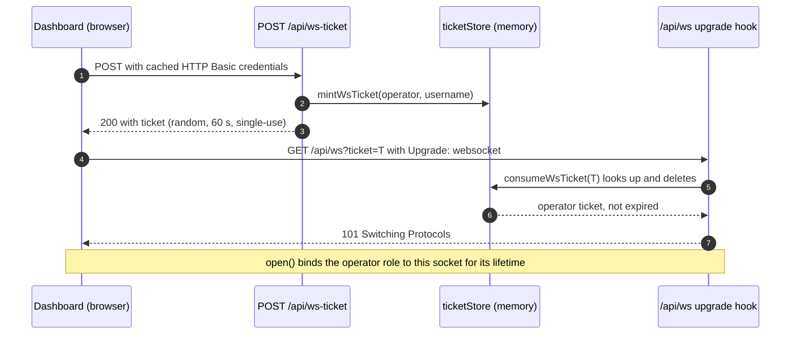
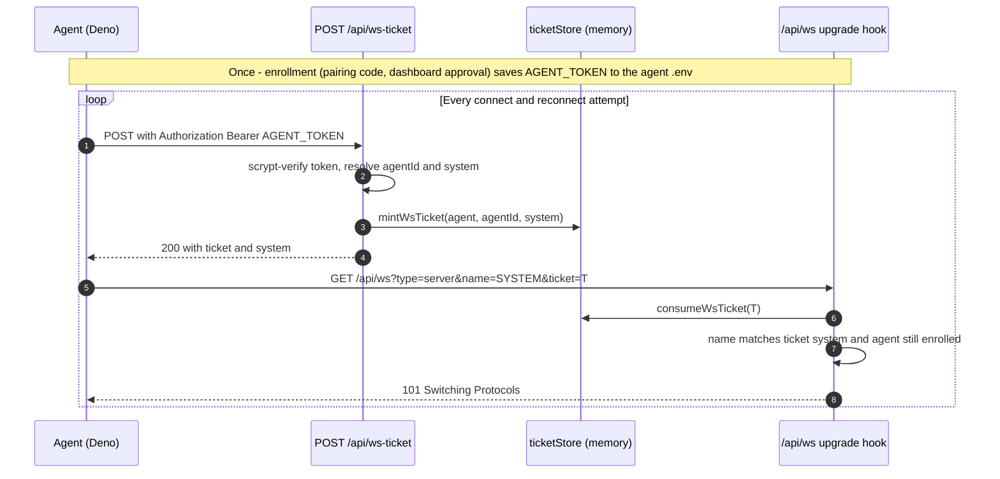
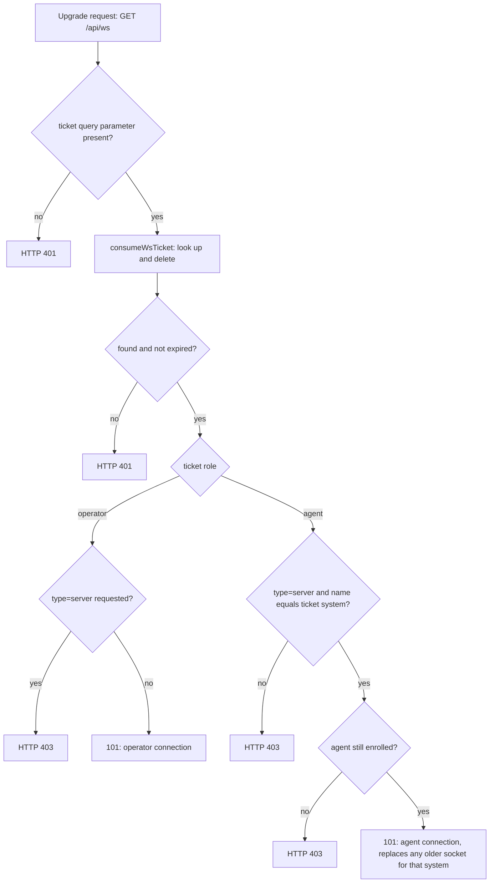
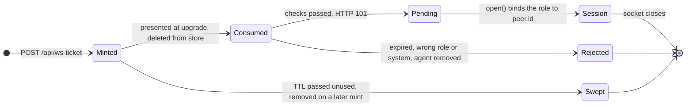
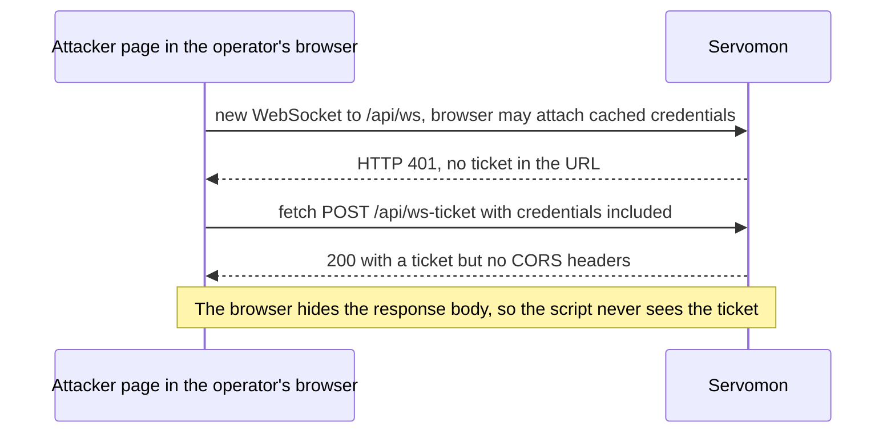

# WebSocket authentication: single-use tickets

`/api/ws` carries remote-control commands from the dashboard to agents (`docker stop/pause/unpause`, `kill <pid>`), so every connection must be authenticated and tied to a role. This document explains how Servomon does that with single-use handshake tickets, why it uses tickets, and what the design costs.

Two kinds of secret appear below:

- A **credential** is long-lived. The operator's HTTP Basic password comes from `NUXT_BASIC_AUTH_USERS`. An agent's `AGENT_TOKEN` is issued during [agent enrollment](agent-enrollment.md). That document explains approval, token collection, and the current device-verification limitations; see "Adding an agent" in the [README](../README.md) for setup.
- A **ticket** is short-lived: 256 random bits, valid for 60 seconds, usable once, tied to a role. Only tickets ever appear in a WebSocket URL. Credentials never do.

## Summary

1. The client sends its credential to `POST /api/ws-ticket` over normal HTTPS. The operator uses HTTP Basic; an agent uses `Authorization: Bearer <AGENT_TOKEN>`.
2. The server returns a ticket bound to that principal: `operator` plus username, or `agent` plus agent id and system name.
3. The client opens `wss://<host>/api/ws?ticket=<ticket>`.
4. The crossws `upgrade` hook consumes the ticket before the handshake completes. Any failure is answered with HTTP 401 or 403, and no socket is created.
5. The connection's role is fixed until it closes. Every reconnect mints a new ticket.

## Why the WebSocket needs its own mechanism

- **Browsers can't set headers on a WebSocket.** The browser API is `new WebSocket(url, protocols)`, with no way to send `Authorization` ([MDN](https://developer.mozilla.org/en-US/docs/Web/API/WebSocket/WebSocket)). The other `/api` routes authenticate with headers, so the WebSocket can't simply reuse them.
- **The protocol leaves authentication to the application.** RFC 6455 says servers "can use any client authentication mechanism available to a generic HTTP server" ([§10.5](https://www.rfc-editor.org/rfc/rfc6455.html#section-10.5)).
- **Relying on credentials the browser attaches automatically invites hijacking.** If the handshake accepted whatever credentials the browser happened to attach, any website the operator visits could open a socket to Servomon on their behalf. That attack is cross-site WebSocket hijacking (CSWSH, [PortSwigger](https://portswigger.net/web-security/websockets/cross-site-websocket-hijacking)).
- **Long-lived credentials don't belong in URLs.** URLs end up in access logs, so the password or `AGENT_TOKEN` must never be part of one ([websocket.org](https://websocket.org/guides/authentication/)).

Tickets meet all four constraints. The credential travels once, in a header, on an ordinary HTTPS request. Only a disposable value goes into the WebSocket URL, and the server checks that value before it accepts the connection.

## How it works

### Dashboard (operator)

The system detail page (`/systems/:name`) opens the command socket. The browser resends the Basic credentials it cached when the dashboard loaded, so the ticket request needs no extra login.

### Agent

Enrollment happens once and gives the agent its `AGENT_TOKEN`. From then on, every connection attempt, including each automatic reconnect, mints a new ticket.

The server takes the agent's system name from the token, never from the request. The `name` query parameter only has to match the name stored on the ticket, so an agent can't connect as another system.

### What the upgrade hook checks

The hook deletes the ticket before any role or system check runs. A ticket presented with the wrong role or system is therefore used up, and a retry with it gets HTTP 401.

### Ticket lifecycle

`Pending` exists because the installed crossws (0.3.1, pulled in by Nitro 2.10) gives `upgrade` no per-connection context: the peer id that later hooks use doesn't exist yet when `upgrade` runs. `upgrade` stores the checked ticket in `pendingTickets`, and `open` moves it onto the peer. Newer crossws releases let `upgrade` return a `context` object that later hooks read as `peer.context` ([crossws hooks](https://crossws.h3.dev/guide/hooks)). After upgrading, that object could replace the map.

### Ticket properties

| Property | Value | Code |
|---|---|---|
| Format | 32 random bytes, base64url (43 characters, 256 bits) | `mintWsTicket`, `web/server/utils/ticketStore.ts` |
| Lifetime | 60 s from mint to use; override with `NUXT_WS_TICKET_TTL_SECONDS` | `ttlSeconds` |
| Uses | One. The first time the ticket is presented, it's deleted, even if the connection is then rejected | `consumeWsTicket` |
| Bound to | Role, plus the operator username or the agent id and system | `WsTicket` type |
| Storage | In-process `Map`, never written to disk | `ticketStore.ts` |
| Cleanup | Used tickets are deleted immediately; expired ones are removed on every mint | `sweepWsTickets` |
| Who can mint | Operator (Basic) or an enrolled agent (Bearer) | `web/server/api/ws-ticket.post.ts`, `web/server/middleware/10-api-auth.ts` |
| Guessing | 2^256 possibilities, and lookup is an exact `Map` match, so there's no partial-match timing to exploit | `Map.get` |

### After the handshake

Each connection's role determines what it may send. Validation happens on every message, not just at connect time.

| Role | May send | Server action |
|---|---|---|
| operator | `kill` with a pid of 1 to 7 digits, or `docker stop/pause/unpause` for a container the target agent has reported in its stored metrics | Forwards the command only to the live agent socket for `system`. The decision is audit-logged whether it's forwarded or dropped |
| agent | Command results matching `commandResultSchema` | Sends the result to every operator socket. Anything else is dropped, so agents can't command each other |

| Close or status | Meaning |
|---|---|
| HTTP 401 at handshake | Ticket missing, unknown, already used or expired |
| HTTP 403 at handshake | Role or system mismatch, or the agent is no longer enrolled |
| 4401 | The socket opened without a session (defensive; shouldn't happen in normal use) |
| 4403 | The agent was removed from the dashboard while connected |
| 4409 | A newer connection for the same system replaced this one |

A failed handshake gives the client no HTTP status to read. The `WebSocket` API reports only an error and close code 1006. Authentication failures therefore show up at the ticket-mint step, which is a normal HTTP request with a readable status. That's where the agent logs `WS ticket mint failed with HTTP 401`.

### Why tickets stop cross-site WebSocket hijacking

PortSwigger describes a vulnerable handshake as one that relies on cookies (or other credentials the browser sends automatically) and carries no "CSRF tokens or other unpredictable values". The ticket is that unpredictable value.

The attacker's page can make the operator's browser request a ticket, but it can't read the response. Without a ticket, the handshake is refused. This protection holds only while `/api/ws-ticket` returns no CORS headers that allow credentials (see Operating considerations). Tickets don't help against XSS on Servomon's own origin: a script running there can mint tickets just as the dashboard does.

## Trade-offs

### Benefits

- Long-lived credentials never appear in a URL.
- Bad connections are refused before the handshake completes, so the server never holds unauthenticated sockets or needs an authentication timeout.
- CSWSH is blocked without depending on cookies or the `Origin` header.
- The browser and the agent use one code path: `resolveUrl` in `shared/lib/WebsocketClient.ts`.
- Revocation is checked on every connect. An agent removed from the dashboard can't mint tickets, and its open sockets are closed with 4403.
- The server sets each connection's identity. A `name` in the URL is checked against the ticket and never trusted on its own.

### Costs

- **An extra HTTP round trip** on every connect and reconnect.
- **Server-side state.** Tickets live in one process's memory, so Servomon must run as a single instance (`web/fly.toml` pins one machine). A restart drops outstanding tickets; clients just mint new ones.
- **Tickets still reach any log that records full URLs.** Usually the logged request is the one that used the ticket, so a ticket read from a log has already been spent. The exception is a proxy that logs the URL but never delivers the request to the app (upstream down, timeout). That ticket stays valid until its TTL runs out, so someone reading logs in real time could replay it within 60 s.
- **The hooks need shared state.** The ticket check runs in `upgrade`, but the session is bound in `open`, so the two share the `pendingTickets` map.
- **No re-authentication mid-connection.** A connection keeps its role until it closes.

### Where the guides disagree

The ticket pattern is long established, but the guidance on query parameters is split:

- **Supports tickets in the handshake.** The pattern goes back to [Armin Ronacher's Websockets 101 (2012)](https://lucumr.pocoo.org/2012/9/24/websockets-101/): a ticket "valid for a few seconds", stored server-side and deleted when redeemed. [Heroku's WebSocket Security guide](https://devcenter.heroku.com/articles/websocket-security) describes the same design and says it "seems to solve the WebSocket authentication problem well".
- **Accepts URL tokens if short-lived.** [websocket.org](https://websocket.org/guides/authentication/) suggests 5–15 minute tokens in URLs and says "never put API keys or long-lived credentials in query parameters".
- **Prefers the first message.** The [OWASP WebSocket Security Cheat Sheet](https://cheatsheetseries.owasp.org/cheatsheets/WebSocket_Security_Cheat_Sheet.html) recommends sending browser tokens in the first message and avoiding query strings. The [python-websockets authentication guide](https://websockets.readthedocs.io/en/stable/topics/authentication.html) goes further: even with single-use tokens, credentials in URLs are "usually considered unacceptable".

Servomon accepts the URL risk because the ticket is single-use and expires in 60 s. In return, the server refuses bad connections before the handshake finishes. If your policy bans credentials in URLs entirely, send the same ticket as the first message instead. The costs are listed in the table below.

### Alternatives considered

| Option | How it works | Why not chosen |
|---|---|---|
| Long-lived token in the URL (`?token=AGENT_TOKEN`) | The client puts its real credential in the WebSocket URL | The credential would sit in every log that records URLs and stay valid indefinitely. websocket.org warns against exactly this |
| Credentials the browser attaches automatically (cached Basic auth, cookies) | Trust whatever the browser sends with the handshake | This is the setup CSWSH exploits, and it's only safe with an `Origin` allowlist. Basic auth has no session to expire or log out, and agents don't use it |
| Session cookie plus `Origin` allowlist | Add a login that sets a `SameSite` session cookie, and check the cookie and `Origin` at upgrade | OWASP prefers this for browsers, but Servomon has no session layer. Building one (login, logout, expiry, CSRF protection) is far more code than tickets, and agents would still need a separate path |
| First-message authentication | Open the socket without authentication, send the token as the first frame, close on timeout | Keeps credentials out of URLs, but the server must accept unauthenticated sockets, add an authentication timeout and a pre-auth state in every hook, and rate-limit unauthenticated connections per IP |
| Token in `Sec-WebSocket-Protocol` | Encode the bearer token as a fake subprotocol, as [Kubernetes does for browser clients](https://github.com/kubernetes/kubernetes/pull/47740) | Misuses a negotiation header, requires the server to echo back a real subprotocol, and still sends a long-lived credential in a header that proxies may log |
| Signed stateless tickets (HMAC or JWT with `exp`) | The server signs `{role, system, exp}` and `upgrade` verifies the signature | Needs no shared store across instances, but single-use still requires a replay cache (state again), plus key management and rotation. This is the natural upgrade path if Servomon ever runs more than one machine |
| `Authorization` header on the agent's handshake | Deno's `WebSocket` accepts a non-standard `headers` option (verified with Deno 2.9.8) | Works for agents only. It would add a second authentication path to the upgrade hook and split the shared client code. One ticket path for both clients is simpler to reason about and test |
| Mutual TLS for agents | Agents present client certificates | The strongest machine identity, but with the current `http_service` setup, TLS terminates at Fly's proxy. Issuing and rotating certificates is heavy for homelab users, and it doesn't help the browser |
| Network-level gate (Tailscale, Cloudflare Access, VPN) | Don't expose the app publicly | A good extra layer and the right containment while a fix ships, but not a replacement: the app itself must be safe when exposed |

## Operating considerations

- **Serve only over TLS (`https`/`wss`).** Over plain `ws://`, anyone on the network path can read a ticket and race the real client to use it before the TTL expires. The ticket request would also expose the long-lived Basic or Bearer credential. Fly.io handles TLS for `*.fly.dev`; self-hosted setups need a TLS-terminating proxy.
- **Run a single instance, or share the store.** A ticket minted on machine A doesn't exist on machine B. To scale out, move tickets to a shared store with an atomic get-and-delete (for example Redis `GETDEL`), or switch to signed tickets with a shared replay cache.
- **Don't add credentialed CORS to `/api/ws-ticket`.** For example, never reflect `Origin` together with `Access-Control-Allow-Credentials: true`. CSWSH protection depends on other origins being unable to read the ticket response.
- **TTL tuning.** Clients mint and connect immediately, so real use takes milliseconds; 60 s is generous. A shorter TTL narrows the log-replay window. The cost is failed attempts on very slow links, which recover on their own because every reconnect mints a new ticket.
- **No clock skew.** Tickets are minted and checked in the same process with `Date.now()`, unlike a JWT `exp` checked on another machine.
- **Logs.** Proxies and platforms that log full request URLs will record tickets, which are normally already used by then (see Costs). Keep such logs out of third-party pipelines, or strip query strings when logging.
- **Revoked agents.** After an agent is removed, its ticket mint returns HTTP 401. The client keeps retrying with exponential backoff (1 s doubling to a 60 s cap) and stops after 20 attempts. To re-enroll, clear `AGENT_TOKEN` in the agent's `.env` and restart it.

## Known gaps and possible hardening

These were deliberately left out of S1. Each one is small to add if the threat model calls for it.

1. **No `Origin` allowlist.** OWASP recommends checking `Origin` on every handshake. Tickets already block CSWSH, but a cheap extra layer for browser connections is to reject any handshake whose `Origin` is present and isn't the app's own. Agents send no `Origin` (verified with Deno 2.9.8), so they're unaffected.
2. **Rejected handshakes aren't logged.** Audit entries cover operator command decisions only. OWASP recommends also logging authentication events at the handshake.
3. **No rate limiting** on handshake attempts or ticket minting. Minting requires a valid credential, and guessing a ticket is infeasible, so the risk is resource use rather than access.
4. **`pendingTickets` is only cleared in `open`.** A handshake that passes `upgrade` but never reaches `open` leaves an entry behind. Creating one requires a valid ticket.
5. **Operator sockets aren't re-validated during a session.** Operator credentials come from the environment and change only on restart, and a restart drops every socket. Per-user revocation would need periodic re-validation, which OWASP suggests every 30 minutes or so.
6. **Tickets aren't tied to the client's IP address.** Ronacher and Heroku both mention storing the IP on the ticket. With a single-use, 60 s ticket the gain is small, and proxies and mobile networks make IP checks brittle.
7. **`kill` checks the pid format but not existence.** The pid isn't checked against the processes the agent reported. Docker commands, by contrast, must name a container the agent has reported.

## Code map

| File | Role in the ticket flow |
|---|---|
| `web/server/middleware/10-api-auth.ts` | Lets `Upgrade: websocket` requests through to the upgrade hook, denies plain HTTP on `/api/ws`, requires Basic or Bearer on `/api/ws-ticket` |
| `web/server/api/ws-ticket.post.ts` | Works out which principal is calling and mints the matching ticket |
| `web/server/utils/ticketStore.ts` | Mint, consume (single-use), TTL, sweep |
| `web/server/api/ws.ts` | `upgrade` checks; `open` binds the session; `message` applies the role rules and writes the audit log; `close` cleans up |
| `shared/lib/WebsocketClient.ts`, `web/shared/lib/WebsocketClient.ts` | `resolveUrl` mints a new ticket on every connection attempt |
| `web/pages/systems/[name].vue` | The dashboard's ticket request |
| `agent/main.ts` | The agent's ticket request |

## Tests

`pnpm test:s1` in `web/` starts the production build with isolated storage and checks the ticket behaviour from outside, over real HTTP and WebSocket connections:

- Anonymous access: `anon cannot mint a WS ticket`, `anon WS handshake is rejected at HTTP layer`, `anon dashboard socket is rejected`, `anon agent socket is rejected`, `anon client cannot forward commands to an agent (S1 PoC)`
- Minting: `operator can mint a WS ticket`, `agent can mint a WS ticket bound to its system`, `WS ticket with wrong operator password is rejected`, `WS ticket with wrong agent token is rejected`
- Ticket rules: `WS ticket is single-use`, `expired WS ticket is rejected` (the suite uses a 2 s TTL), `agent ticket cannot connect as another system`, `operator ticket cannot connect as an agent`
- After the handshake: `operator command reaches its agent and the result comes back`, `agent cannot send commands to another agent`, `removed agent loses token and socket immediately`

## Further reading

- [websocket.org: WebSocket Authentication](https://websocket.org/guides/authentication/): URL parameter vs cookie vs first-message authentication, token renewal, revocation.
- [websocket.org: WebSocket Security Hardening](https://websocket.org/guides/security/): CSWSH, `Origin` validation, rate limiting.
- [Heroku Dev Center: WebSocket Security](https://devcenter.heroku.com/articles/websocket-security): the ticket-based authentication pattern, step by step.
- [Armin Ronacher: Websockets 101](https://lucumr.pocoo.org/2012/9/24/websockets-101/): where the ticket pattern comes from (short-lived, stored server-side, deleted on use).
- [OWASP WebSocket Security Cheat Sheet](https://cheatsheetseries.owasp.org/cheatsheets/WebSocket_Security_Cheat_Sheet.html): `Origin` allowlists, session expiry, first-message tokens, logging.
- [python-websockets: Authentication](https://websockets.readthedocs.io/en/stable/topics/authentication.html): a comparison of first message, query parameter, cookie and user-info credentials, including the case against URLs.
- [PortSwigger Web Security Academy: Cross-site WebSocket hijacking](https://portswigger.net/web-security/websockets/cross-site-websocket-hijacking): how the attack works and why an unpredictable value in the handshake defeats it.
- [RFC 6455 §10.5, Client Authentication](https://www.rfc-editor.org/rfc/rfc6455.html#section-10.5) and [§10.2, Origin Considerations](https://www.rfc-editor.org/rfc/rfc6455.html#section-10.2).
- [MDN: WebSocket() constructor](https://developer.mozilla.org/en-US/docs/Web/API/WebSocket/WebSocket): the only arguments are `url` and `protocols`.
- [Kubernetes PR #47740](https://github.com/kubernetes/kubernetes/pull/47740): the subprotocol-header alternative used for browser clients.
- [crossws: Hooks](https://crossws.h3.dev/guide/hooks): rejecting a connection from the `upgrade` hook, and the `context` mechanism in newer releases.
